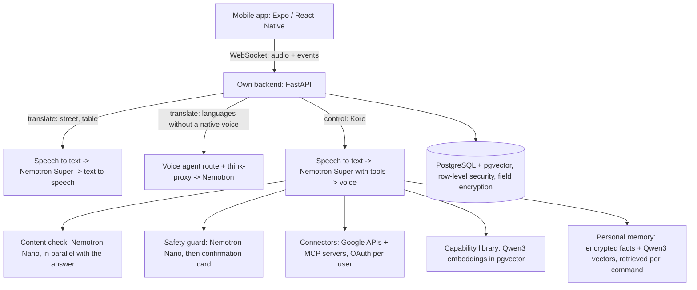

# SpeaKore

**Speak any language, out loud and live, and let Kore run your apps by voice.**

> **About this repository.** SpeaKore is a commercial product by Myqronix Robotics SL, and its source code is private.
> This repository shows how SpeaKore is built and how it uses **NVIDIA Nemotron through Nebius Token Factory**: the
> architecture, the model choices with the measurements behind them, and small runnable examples of the calls.
> Judges: the Android test build and a jury login are in the testing instructions of our submission. Private access
> to the full code on request: **info@myqronix.com**.

## Since the submission

The judges test the version we submitted on 30 October. We keep building: everything below is live on our server
since **31 October 2026, 18:55 CET**, so the submitted app benefits from it too. Each item was measured with real
speech and real model calls in all 16 app languages.

- **Kore helps instead of refusing.** The content check no longer blocks ordinary requests such as reading your own
  mail or asking about your own appointments (400 of 400 allowed in 16 languages); harmful requests are still always
  refused.
- **Mail by voice, safely, in every language.** Kore only sends to an address you said or asked it to remember, and
  asks when it doesn't know one (16 of 16). A made-up address never reaches the confirmation card. Spoken addresses
  ("name at company dot com") work, and so does "mail Maria" followed by "that I'm late".
- **Kore answers in your app language**: its instructions are written in English and end with your app language.
- **Memory works across languages** (ask in Arabic, Hindi or Japanese about something you said in English) and
  "remember …" is instant. "Forget …" removes it at once.
- **Kore never goes silent or deaf on an error**: it says briefly that something didn't work and keeps listening.
- **"Hold on" and calling Kore back by name work in every script** (Коре, コア, 科尔, 코어, كور, कोर).
- **Kore learns how you talk**: a phrase you used twice for the same screen action becomes your personal shortcut.
- **Faster first words**: Kore starts speaking while the answer is still being written.
- **A new app build** with small improvements (a longer connection between commands, a haptic tick when Kore heard
  you) follows tonight. Judges who want it can ask us: info@myqronix.com.

## Demo video

- **Full demo (2:56), with real recordings of the app:** [`media/SpeaKore_demo.mp4`](media/SpeaKore_demo.mp4): Kore greeting you by
  name, a real conversation at the table (English and Dutch), the street mode with an AI as the second phone, "Kore,
  hold on" and a joke with its pause.
- Short version (1:37), as submitted: https://youtu.be/PkgrEEsWz4o

Filmed by hand at home: a screen recording can't capture your own voice, so the best way to judge SpeaKore is to try
it yourself.

## What it does

SpeaKore is a mobile app (Android and iOS) that interprets conversations live and lets you control apps by voice.

- **At the table:** one phone in the middle, 2 to 8 people, each in their own language. Tap your seat and speak; every
  other seat gets your words in their language, dealt like cards around a poker table. Tap a card to hear it.
- **In the street:** two phones pair up. Each person speaks into their own phone and hears their own language.
- **Kore, voice control:** "go to settings", "switch to dark mode", "read my latest mail", "send Maria an email that
  I'm late". Reading happens right away. Anything that sends or changes something shows a confirmation card first, and
  Kore never moves money.
- **Kore is personal:** greets you by name, can be renamed by voice ("call yourself Sonia"), remembers what you ask it
  to remember ("remember that my dentist is Dr García") and finds it again in any language, and pauses when you talk
  to someone else ("Sonia, hold on") until you say its name.
- **Kore stays on topic:** it helps with SpeaKore, your connected services and what you asked it to remember. It does
  not make up the weather or the news. Jokes, compliments and a bit of flirting are fine; explicit, hateful or
  dangerous requests are refused.
- **Connectors:** Gmail and Google Calendar, plus 22 services through their official MCP servers, each connected per
  user with OAuth.
- Speech in **16 languages**. Built for accessibility: screen readers, 200% text, reduced motion.

## Two pipelines on one phone

Two strictly separated pipelines run on the phone: **translate** and **control**. Translate serves the interpreter
modes; control is Kore. The translate pipeline never gets any tools, so a translated sentence can never trigger an
action.



The app never calls an external service directly. Every model call, connector call and key lives in the backend,
which runs on **Nebius AI Cloud** (France, eu-west1) in Docker, with PostgreSQL and pgvector on the same server.

**Memory without fine-tuning.** Kore's memory is retrieval, not fine-tuning: what you ask it to remember is stored
encrypted with a Qwen3 vector, and the facts that fit a command are added to Nemotron's prompt. Each fact can be
forgotten on request and is erased with your data, which a fine-tuned model could not do. Passwords, PINs and card or
account numbers are never stored.

## NVIDIA Nemotron on Nebius Token Factory

All model calls go to the **Token Factory EU endpoint** (OpenAI-compatible API), with thinking mode switched off for
latency (`chat_template_kwargs: {"enable_thinking": false}`).

| Model | Role in SpeaKore |
|---|---|
| `nvidia/nemotron-3-super-120b-a12b` | Interpreting (one-to-one and the table, where one sentence becomes every language at the table in a single call) and Kore's tool calling |
| `nvidia/NVIDIA-Nemotron-3-Nano-30B-A3B` | Safety guard: classifies every connector action before the user sees it, and blocks when in doubt. Content check on every request to Kore, in parallel with the answer |
| `Qwen/Qwen3-Embedding-8B` (1024 dims) | Capability library (per command, only the tools that match go to Kore) and Kore's personal memory |

**Why these models (our own measurements):**
- Interpreting: Nano turned "half past eight" into 9:30 in 3 of 6 clock-time tests; Super got 6 of 6 right and was
  steadier (max 0.6 s vs 3.7 s).
- Kore's tool calling: Super chose the right action in 11 of 12 commands with at most 0.9 s per step. Another
  Nemotron model also scored 11 of 12 but swung between 0.5 and 10 s per step; Nano scored 7 of 12.
- Embeddings at 1024 dimensions matched as well as 4096 in our tests, at a quarter of the size. For the memory, real
  matches scored 0.66 to 0.88 (also across languages: a Spanish question finds a Dutch fact), unrelated commands at
  most 0.60, so the threshold is 0.63.
- Content check: Nano blocked 4 of 4 explicit, violent or hateful requests and let 5 of 5 normal ones through (jokes,
  a love message, a compliment, an app command, mild swearing), in 0.3 to 0.5 s, while Super is already answering.

Token Factory let us use several models in one conversation, each for the job it does best, without running GPUs.

## Measured

Measured on 29 Oct 2026 from our server on Nebius AI Cloud (France) with real speech:

| What | Time |
|---|---|
| One Nemotron Super call | 0.26 to 0.46 s |
| One Nemotron Nano call | 0.16 s |
| Speech to text (Deepgram EU) | 0.34 s |
| In the street: end of a sentence to the other phone's spoken translation | 1.1 to 1.8 s |
| At the table: end of a turn to the spoken translation | 0.5 to 1.9 s |
| One sentence into 7 languages in a single call | 0.9 to 1.4 s |

From a laptop in Spain the same model calls took 0.9 to 1.8 s, which is why the backend runs next to Token Factory.

## How to use

1. **Sign in** and accept the consent screen (it names every service that processes your speech).
2. **At the table:** Translate → At the table. Set each seat's language, tap your seat, speak, tap again when done.
   Everyone else sees and hears it in their own language.
3. **In the street:** both people open Translate → In the street on their own phone and connect with the code or QR
   code. Then just talk.
4. **Kore:** the round button opens Kore, or just speak when the app is open. Try:
   - "What can you do?"
   - "Switch to dark mode", "Go to my profile"
   - "Remember that my dentist is Dr García", then later "What's my dentist called?", and "Forget my dentist"
   - "Tell me a joke" (the punchline comes after a short pause)
   - "Call yourself Sonia"
   - "Sonia, hold on" pauses Kore while you talk to someone else; say "Sonia" to bring it back
   - After connecting Gmail: "Read my latest mail", "Send Ana a mail that I'm running late" (confirmation card first)

## Privacy and safety

- No audio and no transcripts are stored. Logs contain events, never content. The only content we keep is what you
  ask Kore to remember, encrypted, until you tell it to forget or erase your data.
- The interpreter is never censored: it translates what people say. The content check applies to Kore only.
- The raw transcript is always shown next to the translation, so you can see exactly what was heard.
- Every write action passes the Nemotron guard and a confirmation card. Financial connectors only get tools the
  provider marks as read-only.
- Personal data and OAuth tokens are encrypted per field.

## Examples

Small, self-contained scripts that show the calls SpeaKore makes. They are written for this repository; they are not
the production code.

| Example | What it shows |
|---|---|
| `interpret.py` | One-to-one interpreting with Nemotron Super, thinking off, temperature 0 |
| `group_table.py` | The table: one sentence into several languages in a single call |
| `pipeline_separation.py` | The same spoken command is translated by the translate pipeline and executed by Kore |
| `tool_calling.py` | Kore turning a voice command into an app action |
| `safety_guard.py` | Nemotron Nano checking an action first, and blocking when in doubt |
| `embeddings.py` | Qwen3 embeddings picking the right capability for a command |

```bash
pip install -r examples/requirements.txt
export NEBIUS_API_KEY=...        # Windows PowerShell: $env:NEBIUS_API_KEY="..."
python examples/pipeline_separation.py
```

## Simulated conversations

A screen recording can't capture your own voice while the app uses the microphone, so to show both sides of a
conversation we simulated two people, John (English) and Lucía (Spanish), talking through the live server.
See [`simulation/`](simulation/) for the script, the voices and an example run.

## License

The contents of this repository (documentation and examples) are released under the MIT License. The SpeaKore app
itself is not open source.
