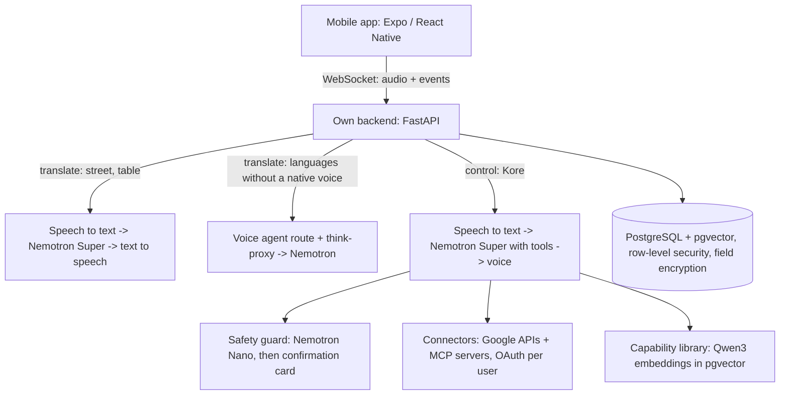

# SpeaKore

**Speak any language, out loud and live, and let Kore run your apps by voice.**

> **About this repository.** SpeaKore is a commercial product by Myqronix Robotics SL, and its source code is private.
> This repository shows how SpeaKore is built and how it uses **NVIDIA Nemotron through Nebius Token Factory**: the
> architecture, the model choices with the measurements behind them, and small runnable examples of the calls.
> Judges are welcome to a test build, a login and private access to the full code on request: **info@myqronix.com**.

## What it does

SpeaKore is a mobile app (Android and iOS) that interprets conversations live and lets you control apps by voice.

- **At the table:** one phone in the middle, 2 to 8 people, each in their own language. Tap your seat and speak; every
  other seat gets your words in their language, dealt like cards around a poker table. Tap a card to hear it.
- **In the street:** two phones pair up. Each person speaks into their own phone and hears their own language.
- **Kore, voice control:** "go to settings", "switch to dark mode", "read my latest mail", "send Maria an email that
  I'm late". Reading happens right away. Anything that sends or changes something shows a confirmation card first, and
  Kore never moves money.
- **Connectors:** Gmail and Google Calendar, plus 22 services through their official MCP servers, each connected per
  user with OAuth.
- Speech in **16 languages**. Built for accessibility: screen readers, 200% text, reduced motion.

## Two pipelines on one phone

Two strictly separated pipelines run on the phone: **translate** and **control**. Translate serves the interpreter
modes; control is Kore. The translate pipeline never gets any tools, so a translated sentence can never trigger an
action.



The app never calls an external service directly. Every model call, connector call and key lives in the backend.

## NVIDIA Nemotron on Nebius Token Factory

All model calls go to the **Token Factory EU endpoint** (OpenAI-compatible API), with thinking mode switched off for
latency (`chat_template_kwargs: {"enable_thinking": false}`).

| Model | Role in SpeaKore |
|---|---|
| `nvidia/nemotron-3-super-120b-a12b` | Interpreting (one-to-one and the table, where one sentence becomes every language at the table in a single call) and Kore's tool calling |
| `nvidia/NVIDIA-Nemotron-3-Nano-30B-A3B` | Safety guard: classifies every connector action before the user sees it, and blocks when in doubt |
| `Qwen/Qwen3-Embedding-8B` (1024 dims) | Capability library: per command, only the tools that match go to Kore |

**Why these models (our own measurements):**
- Interpreting: Nano turned "half past eight" into 9:30 in 3 of 6 clock-time tests; Super got 6 of 6 right and was
  steadier (max 0.6 s vs 3.7 s).
- Kore's tool calling: Super chose the right action in 11 of 12 commands with at most 0.9 s per step. Another
  Nemotron model also scored 11 of 12 but swung between 0.5 and 10 s per step; Nano scored 7 of 12.
- Embeddings at 1024 dimensions matched as well as 4096 in our tests, at a quarter of the size.

Token Factory let us use several models in one conversation, each for the job it does best, without running GPUs.

## Measured

End of a spoken sentence to the start of the spoken translation, with real speech, measured on 29 Oct 2026 from a
laptop in Spain against Token Factory EU:

| Direction | Time |
|---|---|
| Spanish → Dutch | 0.99 s |
| Dutch → Spanish | 1.53 s |

## Privacy and safety

- No audio and no transcripts are stored. Logs contain events, never content.
- The raw transcript is always shown next to the translation, so you can see exactly what was heard.
- Every write action passes the Nemotron guard and a confirmation card. Financial connectors only get tools the
  provider marks as read-only.
- Personal data and OAuth tokens are encrypted per field.

## Examples

Small, self-contained scripts that show the calls SpeaKore makes. They are written for this repository; they are not
the production code.

```bash
pip install -r examples/requirements.txt
export NEBIUS_API_KEY=...        # Windows PowerShell: $env:NEBIUS_API_KEY="..."
python examples/interpret.py
python examples/tool_calling.py
python examples/embeddings.py
```

## License

The contents of this repository (documentation and examples) are released under the MIT License. The SpeaKore app
itself is not open source.
